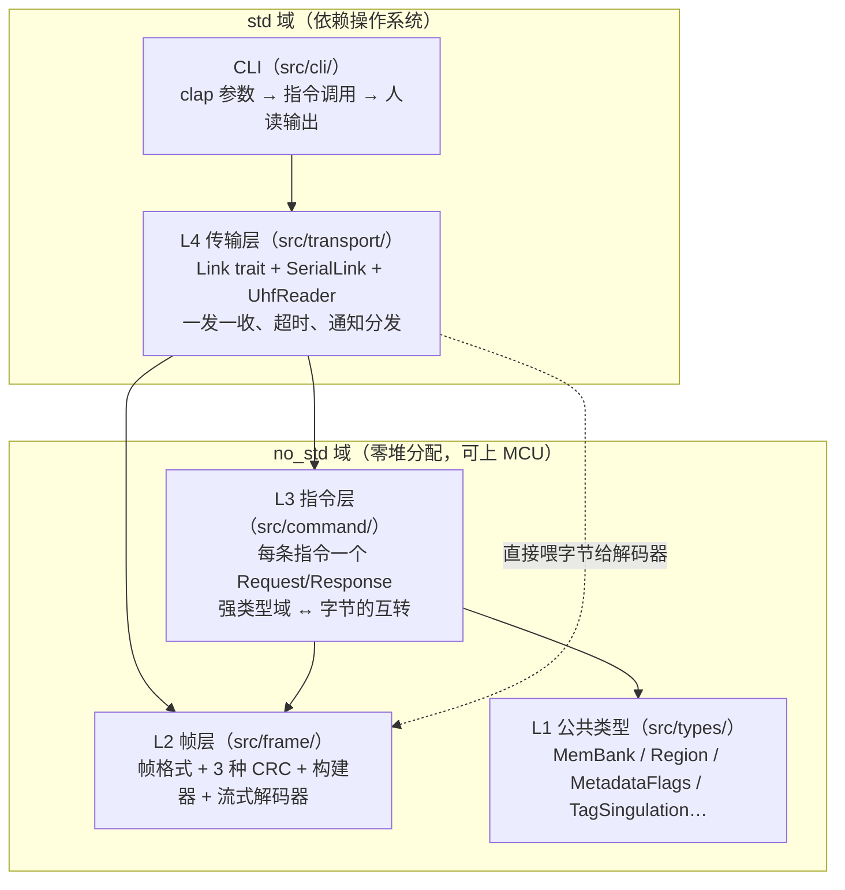
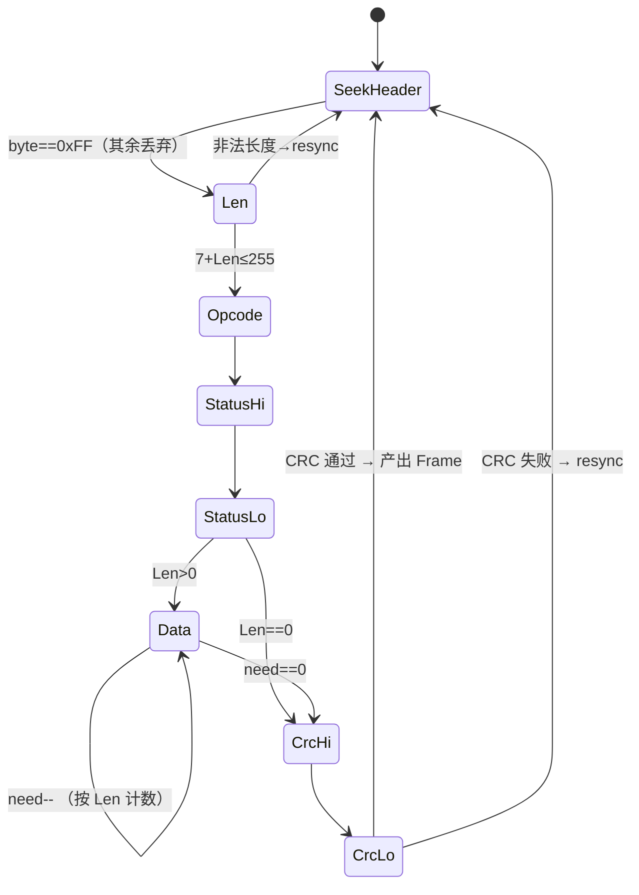

# 07 协议栈原理详解

> 本文是协议栈的**原理性讲解**：为什么这样设计、每一层解决什么问题、关键算法如何工作。
> 查询型内容（指令清单、域定义、页码）请配合 `01-protocol-summary.md` / `03-commands.md` 使用；
> 本文与代码一一对应，若行为不一致以代码为准并回改本文。

---

## 1. 全景：四层架构 + CLI

协议栈把"和 EX10 模块说话"这件事拆成四层，每层只对上一层负责：



分层的**判定标准是依赖方向**，不是目录好看：

| 层 | 知道什么 | 不知道什么 | 编译环境 |
|---|---|---|---|
| L1/L2/L3 | 字节、域、手册语义 | 串口、时间、线程 | `no_std`，零堆分配 |
| L4 | L2/L3 的产物 + `std::time`/`std::io` | 具体指令的业务含义 | 仅 `std` feature |
| CLI | 全部 | —— | 二进制 `uhf-demo` |

这样切分带来两个直接收益：

1. **协议核心可移植**：L1–L3 不碰堆、不碰 OS，将来换到 MCU（ESP32 等）只需重写 L4 的 `Link` 实现；
2. **可测试性**：L2/L3 的全部行为都能用手册十六进制实例做纯函数断言（108 项测试不需要设备在线）。

---

## 2. 物理通信模型

- 载体：`/dev/ttyUSB0`，**115200 8N1**，无流控（`SerialLink`，见 `src/transport/serial.rs`）；
- 模型：**严格的一发一收（半双工请求-应答）**。请求发出后、收到应答前，不得发下一条指令；
- 异步例外：异步盘存（0xAA48）激活期间，模块会**主动**推通知包，此时主机侧用 `next_notification()` 收，而不是等应答。

一发一收纪律落到代码就是 `UhfReader::tx_and_wait` 的结构：`write_all → 循环 read → 喂解码器 → 匹配到应答才返回`。在应答匹配之前的所有其它帧（主要是 0xAA 通知）都被吸收掉，不报错、不排队。

### 超时模型

应答超时 = **5s 基数 + 指令执行时间提示**（`RESPONSE_TIMEOUT_BASE` + hint）：

- 普通查询指令 hint = 0；
- 同步盘存 0x22 的 hint = 盘存时长本身；
- 回波检测 0xAA4A 用固定 30s（FCC 全频段扫描约 25s，`ECHO_DETECT_TIMEOUT`）；
- 0x09 回 Bootloader 成功后**额外 `sleep 250ms`**（手册 p.27 要求，模块重启需要时间）。

---

## 3. 帧格式（L2，`src/frame/mod.rs`）

### 3.1 通用帧（手册 §3.1 p.14-15）

```
请求: FF | Len | Op      | Data[N]              | CRC16      总长 = 4+N
响应: FF | Len | Op | St(2B) | Data[N]           | CRC16      总长 = 7+N
                └─ Status ──┘
```

三个容易踩的口径问题：

1. **Len 只数 Data**。响应帧里 `N = Len`，但响应比请求多 2 字节 Status——所以"同一指令"的请求/响应 Len 不同；
2. **总长硬上限 255 字节**（`MAX_FRAME_LEN`）：响应 `7+Len ≤ 255` ⇒ `Len ≤ 248`。解码器在收到 Len 字节时立刻做这个检查，非法直接重同步（见 §6.3）；
3. **多字节整数全部大端**，CRC 亦以大端附加帧尾（高字节在前）。

### 3.2 扩展帧（手册 §3.2 p.16）

扩展指令是"帧中帧"：外层仍是一个 Op=0xAA 的通用帧，Data 里再包一层私有壳。

```
请求: FF | Len | AA | "Moduletech"(10B) | SubCode(2B) | SubData(N) | SubCRC(1B) | BB | CRC16
响应: FF | Len | AA | Status(2B)        | "Moduletech"(10B) | SubCode(2B) | SubData(N) | CRC16
```

请求/响应壳的**不对称**是手册原文如此、真机验证过的：

| | 请求侧 | 响应侧 |
|---|---|---|
| 前导 0xAA | 有（SubCode 高字节恰为 0xAA） | 无 |
| SubCRC + 0xBB | 有 | **都没有** |

`RawFrame::is_extended()` 的判据因此是：`opcode == 0xAA && data 以 "Moduletech" 开头`（`data[0..10] == EXT_MARKER`），SubCode 恒在 `data[10..12]`，SubData 从 `data[12..]` 起（`ext_payload()` 剥壳）。

### 3.3 Len 的两种口径（扩展帧专属陷阱）

- **Len = 14 + N，不含终止符 0xBB**；
- **帧 CRC 却覆盖到 0xBB（含）**。

即 `0xBB` 处在"Len 说不包含、CRC 说包含"的位置。这是从手册 p.59/65/143/144/163 五个实例帧交叉验证锁定的结论，`build_extended` 里 `out.push((14 + subdata.len()) as u8)` 与 `finish()` 对整个 `out[1..]` 计算 CRC 正是这两条的直接翻译。

---

## 4. 校验体系：三种"CRC"（`src/frame/crc.rs`）

协议里有三个校验域，算法完全不同，**只有一个是真正的标准 CRC**：

| 域 | 算法 | 覆盖范围 | 输出 |
|---|---|---|---|
| 帧 CRC16 | **私有非标准**逐位算法 | `Len..Data`（或 0xBB），**帧头 0xFF 不参与** | 大端 2B |
| TagCRC | 标准 ISO6C CRC-16 | PC+EPC | 取反输出 |
| SubCRC | **累加和** | SubCode..SubData 末（含 SubCode） | 低 8 位 |

### 4.1 帧 CRC：为什么不能用的任何标准库（本项目最重要结论）

手册附录 1 的 C 代码里，**数据位被插入移位寄存器的 bit0**，而一切标准 CRC-16 的数据都是经 `reg ^= byte << 8` 从 bit8 进入的：

```text
标准 CCITT 骨架                EX10 私有骨架
reg = 0xFFFF                   reg = 0xFFFF
for b in data:                 for b in data:            # 跳过帧头 0xFF
  reg ^= b << 8                  for bit in b (MSB first):
  repeat 8:                        xorFlag = reg & 0x8000
    reg = (reg<<1)^poly?…          reg = (reg << 1) & 0xFFFF
                                    if bit: reg |= 1      # ★ 数据位进 bit0
                                    if xorFlag: reg ^= 0x1021
```

差之一个移入位，谬以整个多项式空间：

- 与 CCITT-FALSE / MODBUS / XMODEM 等标准参数全不匹配；
- 对 65536 个候选 poly 做暴力搜索**无解**——它根本不构成任何 `(poly, init, refin, xorout)` 参数组合；
- 2026-10-29 真机实测：标准 CRC 帧**无响应**。

所以 `crc16_ex10` 是 15 行逐位直译（见 `src/frame/crc.rs`），项目**禁止**引入 `crc` crate 计算帧 CRC。黄金向量：

| 输入（从 Len 起） | CRC |
|---|---|
| `00 03` | `1D 0C` |
| 真机 0x03 响应的 24 字节 body | `B0 31` |

### 4.2 TagCRC：反而是标准的

附录 5，即 ISO18000-6C（Gen2）规范里的 CRC-16：seed `0xFFFF`、poly `0x1021`、逐位、**输出取反**（等价 xorout 0xFFFF），输入为 `PC+EPC`。用于校验 0x29 缓冲区标签数据、异步通知包里标签的完整性。

### 4.3 SubCRC：根本不是 CRC

附录 7，就是从 **SubCode 开始**（含 SubCode 自身，这个"含"是真机实测钉死的）到 SubData 末尾的**逐字节累加和取低 8 位**：

```text
sub_crc(&[AA 40 04 00]) = 0xEE
```

`build_extended` 在写 SubCode/SubData 的同一个循环里顺手累加，不重复扫描。

---

## 5. 帧构建器（`src/frame/builder.rs`）

构建是解析的镜像，只有两个函数：

- `build_request(op, data, out) -> usize`：`FF Len Op Data CRC`，超 255 字节返回 `EncodeError::FrameTooLong`（`out` 由调用方给 `FrameBuf = heapless::Vec<u8,256>`，容量 256 > 255 上限，push 不会失败，代码里因此可以用 `let _ =` 忽略）；
- `build_extended(subcode, subdata, out) -> usize`：按 §3.2/§3.3 的口径拼壳——Len 计 14+N 不含 BB、SubCRC 边写边累加、最后 `finish()` 对 `out[1..]` 统一算帧 CRC。

设计意图：**编码失败只可能发生在入口（长度/参数校验），一旦开始写字节就不会中途失败**——这对嵌入式调用方（拿到 `Result<usize>` 就能直接把 `out[..n]` 丢给 UART）是刚需。

---

## 6. 流式解码器（`src/frame/decoder.rs`，本 crate 核心交付物）

### 6.1 为什么必须是"逐字节状态机"

串口给你的字节流**没有消息边界**，且不干净：

- **粘包**：两条帧的字节连续到达（`read()` 一次可能同时含上一条尾巴和下一条头）；
- **断包**：一条帧被拆成多次 `read()`（115200 下很常见）；
- **噪声**：电平抖动、模块复位期间的乱码。

按"先收够 N 字节再整体解析"的思路，任何一个场景都会丢帧。所以解码器做成**每喂一个字节推进一格**的状态机，帧边界由协议自身的结构（Len 定长头 + CRC 收尾）恢复：



（`resync` 的落点取决于缓冲内是否还能扫到 0xFF，见 §6.3；图中简化为回 `SeekHeader`。）

注意状态机**只解析设备→主机形态**（Op 之后恒有 2 字节 Status，通知包也是）。主机→设备的请求帧不需要解码，只有构建。

### 6.2 三种返回值

```rust
pub enum Outcome<'a> {
    NeedMore,             // 字节已吸收，凑不齐一帧
    Frame(RawFrame<'a>),  // CRC 已校验通过的完整帧（零拷贝借用内部缓冲）
    Resynced,             // 触发了一次重同步（可观测信号，用于日志/统计）
}
```

### 6.3 错误恢复：重同步策略（解码器可靠性的关键）

两种失败路径，处理方式一致——**不丢字节流、在已收缓冲内从第 1 字节起重扫 0xFF**（`StreamDecoder::resync`）：

1. **Len 非法**（`7+Len > 255`）：说明这个 0xFF 大概率是噪声/数据伪影。在缓冲内重扫，扫不到就整体丢弃回 `SeekHeader`；
2. **CRC 失败**：说明帧内容损坏，但**坏帧的字节里可能恰好嵌着下一帧的帧头 0xFF**。重扫把 0xFF 及其后的字节搬到缓冲头，状态置 `Len` 等下一字节——下一帧因此得救。

两条兜底性质：

- `SeekHeader` 状态丢弃一切非 0xFF 字节 ⇒ **帧前噪声天然免疫**；
- 就算噪声伪造出"合法的 Len"把状态机骗进 Data 阶段，它最终也要收满 `7+Len` 字节过 CRC，**CRC 必失败 → 重同步**，坏状态不可能永久滞留（测试 `fake_len_noise_eventually_resyncs` 专门验证这一点）。

### 6.4 零拷贝产出与借用规则

CRC 通过后解码器**不清缓冲**，直接把 `&buf[5..5+Len]` 作为 `RawFrame.data` 借出去（`frame_pending` 标志）；下一次 `feed` 开始时才 `clear()`。因此规则是：**持有 `Outcome::Frame` 期间不得再调用 `feed`**。批量接口 `feed_slice_with` 在回调返回后才继续喂，天然满足该规则。

L4 层若需要跨调用持有数据（CLI 打印、异步收集），用 `RxFrame`（`FrameBuf` 拷贝）切断借用——这就是 `transport::RxFrame` 存在的原因：**借用归 L2 一瞬，所有权归调用方**。

### 6.5 层间解耦

解码器只负责外层帧（头/长/Op/Status/Data/CRC），**不理解** 0xAA 壳里的 Marker/SubCode/SubData——那是 `RawFrame::is_extended/subcode/ext_payload` 和指令层的事。好处：通知包、扩展响应、普通响应在解码器眼里完全同构，扩展协议演进不影响状态机。

---

## 7. 指令层（L3，`src/command/`）

### 7.1 Request/Response 模式

每条指令一对儿，落在各自模块（`bootloader/get/set/inventory/access/persist/async_inventory/misc`）：

```rust
pub struct XxxRequest { /* 强类型参数，带合理 Default */ }
impl XxxRequest {
    pub fn encode(&self, out: &mut impl Extend<u8>) -> Result<(), EncodeError>;  // 只产出 Data 域
}
pub fn parse_xxx(frame: &RawFrame) -> Result<XxxResponse, DecodeError>;          // 消费整个帧视角
```

三条纪律（`command/mod.rs` 文档注释）：

1. **字段名与手册英文域一致**，doc 注明页码——对照手册排查时可以逐字搜；
2. **编码只产出 Data 域**，套帧（头/Len/CRC）统一交给 L2 构建器——同一套帧逻辑服务所有指令；
3. **解析永不 panic**：所有读取经"够不够长"检查，越界返回 `DecodeError::Truncated`。恶意/异常数据最多变成 `Err`，不会炸掉上位机。

### 7.2 公共类型层（L1）解决"一域多用"

很多域被多条指令共享，单独建模在 `src/types/`：

| 类型 | 共享方 | 要点 |
|---|---|---|
| `MetadataFlags`/`Metadata` | 0x21/0x22/0x29/0xAA48… | 8 个位域→变长元数据；`PhaseMode` 区分两种相位语义（0x21/0x28 起止 8 位 vs 0x22/异步止相 12 位） |
| `TagSingulation` | 所有盘存/访问指令 | Select-Option bits 决定 Address/Length/Data/AccessPassword 哪些域实际在线 |
| `RegionCode` | 0x67/设置跳频 | 各区域**默认跳频表**内置（`default_hopping_table`） |
| `MemBank`/`BaudRate` | 访问/配置指令 | 2bit bank 编码等 |

`Metadata` 的解析是典型的"游标"式：`parse_metadata(data, flags, phase_mode) -> (Metadata, 消费字节数)`，返回消费量让调用方接着解下一条标签——多条标签在一个 Data 域里排排坐时（0x29 缓冲区、异步包）靠它顺序切分。

---

## 8. 传输层（L4，`src/transport/`，仅 std）

### 8.1 Link 抽象

```rust
pub trait Link {
    fn write_all(&mut self, buf: &[u8]) -> std::io::Result<()>;
    fn read(&mut self, out: &mut [u8], timeout: Duration) -> std::io::Result<usize>; // 超时返回 Ok(0)
}
```

串口只是默认实现（`SerialLink`）。Link 只卖"写字节 + 带超时读字节"，于是 BLE/TCP/MCU-UART 都是将来一个 struct 的事，`UhfReader<L: Link>` 的全部逻辑不用改。

### 8.2 一发一收的实现骨架

```rust
fn tx_and_wait(&mut self, tx, opcode, subcode, timeout) -> Result<RxFrame, _> {
    self.link.write_all(tx)?;
    loop {                                    // 直到 deadline
        let n = self.link.read(&mut chunk, wait)?;   // ≤100ms 粒度切片
        for &b in &chunk[..n] {
            if let Some(frame) = self.absorb(b, opcode, subcode)? { return Ok(frame); }
        }
    }
}
```

`absorb` 是应答匹配的核心，规则按帧类型分岔：

- **等普通指令**（opcode ≠ 0xAA）：`f.opcode == opcode` 即命中。0xAA 通知包 opcode 不匹配，被自然吸收；
- **等扩展指令**（opcode == 0xAA）：应答和通知的 opcode **都是 0xAA**，靠 `f.subcode()` 区分——扩展壳且有正确 SubCode 才是应答；无壳（`subcode() == None`）即通知，跳过。

命中后先查 `status != 0` ⇒ `TransportError::Status(Status::from_u16(..))`；状态码枚举覆盖手册 p.164-167 全表（宏 `define_status!` 生成），未知值落 `Status::Unknown(u16)` 不丢失。

### 8.3 异步盘存与通知

`next_notification(timeout)` 只返回"opcode=0xAA 且**非**扩展壳"的帧（标签数据包 / 心跳包 `"XTSJ"` / 轮询包）。两个特殊状态码在任何路径出现都要处理：

- `0xAA49` / `0xAA59`：异步盘存被其它指令打断——`absorb` 里清除 `async_active` 标志，`next_notification` 里直接以 `Err(Status)` 返回，调用方知道该重新发起而不是傻等。

### 8.4 高层封装

`UhfReader` 在 transact 之上还提供常用指令的直达方法（`get_version/inventory/read_tag_buffer/read_memory/...`）：内部完成"构造 Request → encode → transact → parse → owned 结果"，把 L3+L4 的样板折叠成一次调用。CLI 与库用户共享这套方法。

---

## 9. 错误模型（`src/error.rs` + `transport::TransportError`）

两层错误，**越靠近设备越"协议化"，越靠近用户越"上下文化"**：

```
EncodeError / DecodeError / Status      ← no_std 层，纯数据问题（帧太长/截断/CRC 错/非法值/设备状态码）
            │
            ▼ From/组合
Error（no_std 统一入口，+Timeout）
            │
            ▼
TransportError（std 层，+Io(std::io::Error)）
```

要点：

- `no_std` 层错误全部 `Copy`（无堆、无字符串格式化负担），`BadValue(&'static str)` 用静态串定位字段；
- `TransportError` 才引入 `std::io::Error` 与 `std::error::Error` 实现；
- 状态码不是错误枚举的变体而是独立 `Status` 类型（`src/status.rs`），因为 CLI 需要把它**打印成人话**（`Display` 含中文描述），而不仅仅是匹配分支。

---

## 10. no_std 与零堆分配

`#![cfg_attr(not(feature = "std"), no_std)]`（`src/lib.rs`）。约束与手法：

| 需求 | 手法 |
|---|---|
| 帧缓冲 | `FrameBuf = heapless::Vec<u8, 256>`（255 上限 + 1 余量） |
| 标签列表 | `heapless::Vec<OwnedTag, 64>` 等定容容器 |
| 错误 | `Copy` 枚举 + `&'static str`，无 `String`/`Box` |
| 时间 | L1–L3 不含时间概念；超时只存在于 L4（`std::time::Instant`） |
| 分支验证 | `cargo build --no-default-features` 是 CI 门槛，漏网之鱼（误用 std）当场编译失败 |

`cargo test`（std 模式）与 no_std 门槛共用同一份 L1–L3 代码，测试本身不需要设备。

---

## 11. 测试与验证体系

三层防线（详见 `04-testing.md`）：

1. **黄金向量单测**：手册 40+ 帧十六进制实例 + 真机实测帧，全部做成"编码→字节逐字节断言 / 字节→解析→字段断言"双向测试（`src/frame/builder.rs`、各 command 模块 `#[cfg(test)]`）。手工抄 PDF 的向量曾发现手册 p.68 印刷错误（DataLength/MetadataFlags 域印错，重建后 CRC 命中 `0ABF`），双向断言就是为此存在的；
2. **解码器鲁棒性测试**：粘包 / 三段断包 / 帧前噪声 / 坏 CRC 后紧跟好帧 / 非法 Len / 伪造 Len 的最终兜底（§6.3 列出的场景各有专属测试）；
3. **真机冒烟**：`/dev/ttyUSB0` 上按 CLI 子命令逐项过（2026-10-29 全绿，见 AGENTS.md「当前状态」）。

已知的手册向量不可靠来源：`probe_crc_full.py` 的 FRAMES 表对扩展帧有截尾错误（17 项 MISS），**勿作向量来源**；权威向量在 AGENTS.md 与单测里。

---

## 12. 已知陷阱与勘误速查

| # | 陷阱 | 结论来源 |
|---|---|---|
| 1 | 帧 CRC 是非标准算法，禁用一切标准 CRC 库 | 真机 + 65536 poly 暴力搜索（§4.1） |
| 2 | 扩展帧 Len 不含 0xBB，CRC 含 0xBB | 5 个手册实例帧交叉验证（§3.3） |
| 3 | 扩展响应无 SubCRC/Terminator、无前导 0xAA | p.65/163 接收实例 |
| 4 | SubCRC 计算范围**含 SubCode 本身** | 真机实测 `AA 40 04 00 → EE` |
| 5 | p.68 异步盘存示例帧印刷错误（Len 应 0x27、Flags 应 0x0016） | `probe_p68.py` 重建，CRC 命中 `0ABF` |
| 6 | 0x06 设波特率已失效 → 用扩展 0xAA40 KEY=0x06 | 手册勘误 |
| 7 | 0x2A 清缓存已无效 | 手册勘误 |
| 8 | p.41 0x29 尾域：真机 Fw 2.0.7.3 的 0x29（flags=0x003F）尾 2 字节实测为 TagCRC（与 PC+EPC 的 ISO6C CRC 8/8 命中），CLI 同时标注 PHASE2/TagCRC | 真机 |
| 9 | 异步通知包 EPCLength 单位是**字节**且含 PC+TagCRC（0x29 是 bit，不同！） | p.61-62 |
| 10 | Boot 层需先 0x04 进 APP 层才能盘存；用 0x0C 查询当前阶段 | 真机 |
| 11 | EX 异步盘存在 FCC 区域固件不支持 | 真机 |

---

## 13. 一次完整交互的走查（0x03 获取版本）

以 CLI `uhf-demo info` 的第一跳为例，把全文串起来：

**① 构建请求**（`build_request(0x03, &[])`，Data 为空）：

```
FF 00 03 | 1D 0C        ← Len=0, Op=03; CRC 对 [00 03] 用私有算法算出 1D0C，大端附加
```

**② 串口写出**，`UhfReader::tx_and_wait` 进入读循环（deadline = now + 5s）。

**③ 模块应答**（真机实测 26 字节）：

```
FF 14 03 00 00 18 06 04 00 A9 00 00 01 20 20 07 03 20 07 03 00 00 00 00 10 | B0 31
│  │  │  └─┬┘ └────────────────── Data[0x14=20B] ─────────────────────┘    └─ CRC
│  │  Op   Status=0x0000（成功）                                          B031 ✓
│  Len=20
帧头（不参与 CRC）
```

**④ 逐字节喂入 `StreamDecoder`**：

`FF`→SeekHeader✓ → `14`→Len 合法(7+20≤255) → `03`→Op → `00 00`→Status → 20 字节 Data（need 计数到 0）→ `B0`→CrcHi → `31`→CrcLo：重算 `crc16_ex10(buf[1..24]) == B031` ✓ ⇒ 产出 `RawFrame{ len:20, op:0x03, status:0, data:&buf[5..25] }`。

**⑤ `absorb` 匹配**：`f.opcode == 0x03 == 期望`，status==0 ⇒ 拷贝为 `RxFrame` 返回。

**⑥ L3 解析**：`parse_version(&rx.view())` 把 20 字节 Data 切成 BootVer/HwVer/FwDate/FwVer/Proto 五个 4 字节域（`HwVersion` 再拆芯片类型/天线口/认证区/序号），返回 `VersionInfo`。

**⑦ CLI 格式化输出**（人读），一次交互闭环。

若 ④ 中 CRC 被线路噪声打坏：解码器不产出帧，而是在缓冲内重扫 0xFF 重同步（`Resynced`），上层只是晚一拍收到结果或最终 `Timeout`——**单字节损坏不传染到后续帧**，这就是整套设计的落点。
